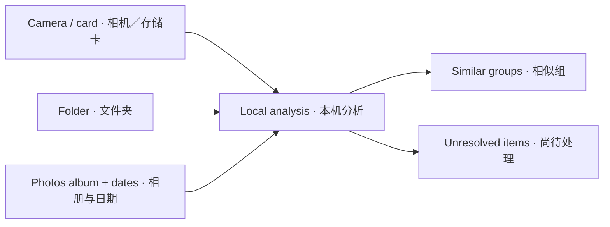
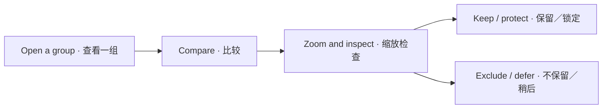
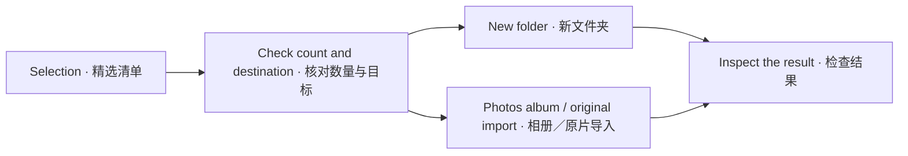

# WorthPhotos · 择影

<p align="center"></p>
<p align="center"><strong>Choose the photos worth keeping, privately on your Mac.</strong></p>
<p align="center"><a href="README.zh-CN.md">简体中文</a> · <a href="https://github.com/zGzARY/WorthPhotosSelector/releases/latest">Download for macOS</a> · <a href="#quick-start">Quick start</a></p>

WorthPhotos is a native macOS photo selection app for everyday moments, portraits, events, work, and travel. It groups visually similar photos, offers on-device quality recommendations, and lets you make the final choice.

**Apple Silicon · macOS 15+ · Chinese interface · no account or remote analysis service**

> Previously named 旅拍精选 / TravelSelect. The broader name reflects the app's photo selection workflow. Existing sessions remain compatible.

## Download and install

1. Open [Releases](https://github.com/zGzARY/WorthPhotosSelector/releases/latest) and download **WorthPhotos-1.3.2-macOS-arm64.zip**.
2. Extract the ZIP and drag **WorthPhotos.app** into **Applications**.
3. Open the app and choose a photo source. Photos access is requested when you connect to Apple Photos or confirm an import; folders and cards use the system picker.
4. Optional: compare the ZIP's SHA-256 with the included **SHA256SUMS.txt**.

The downloadable build is **ad-hoc signed and not notarized by Apple**. If macOS blocks an app you trust, follow [Apple's official instructions](https://support.apple.com/102445) in System Settings → Privacy & Security → Open Anyway. You may need an administrator account. Do not turn off system-wide security protections.

The first public package targets **arm64 only**. An Intel build is not provided. The minimum deployment target is macOS 15; this does not mean every macOS version or camera model has been tested.

## What it does

| Capability | Behavior |
| --- | --- |
| Three photo sources | USB cameras / mounted cards, folders, and Apple Photos albums with a date range |
| Similar-photo groups | Local Vision features and capture time, with four grouping levels |
| Side-by-side review | Multi-photo comparison, independent zoom, keep / exclude / defer, protected choices, and undo |
| Recommendations | Whole-image aesthetics; optional face capture quality when comparable people are explicitly confirmed |
| Small preference calibration | Choose among 1 or 3 groups to adjust the available image-versus-person quality tradeoff |
| Original-preserving output | Copy selected originals to a new folder, import originals into Photos, or create a Photos selection album |
| Resume work | Saved selections and review position; camera reconnection and import progress receipts |

Recommendations are aids, not a guarantee of the best photograph or expression. “Exclude” means excluded from this output. **The app does not automatically delete source photos or reclaim storage space.**

## Quick start

1. Click **选择照片** (“Choose photos”) and choose a camera / card, folder, or Photos album and date range. Analysis and grouping start after selection.
2. Review the groups. Select photos and click **比较** (“Compare”) to inspect them side by side.
3. Confirm what to keep, lock important photos, or defer a group. You can adjust grouping and selection preferences under **更多** (“More”) or Settings.
4. Click the output button. Check the destination, selection count, and names before confirming.
5. Inspect the result in Finder or Photos. Keep the source until you have checked the output.

| Chinese control | Meaning |
| --- | --- |
| 选择照片 | Choose photos |
| 比较 | Compare |
| 保留 / 不保留 | Keep / exclude from this selection |
| 锁定保留 | Protect a keep choice |
| 稍后处理 | Defer review |
| 采用推荐 | Accept recommendations |
| 导出精选照片 / 导入精选原片 / 生成精选相册 | Export selection / import originals / create selection album |
| 待整理 | Remaining reviewed photos |

### 1. Review similar groups



*Analysis groups the selected scope. Unavailable or incomplete items remain separate from completed recommendations.*

### 2. Compare before deciding



*Your confirmed choices and protection locks take priority. Excluding a photo affects this selection; its source stays in place.*

### 3. Check the output



*Review the destination before confirming. Unresolved items are listed separately. The source originals remain available.*

## Sources and output

- **Folders:** JPEG, HEIC / HEIF, and PNG are supported by the folder analysis path. Byte-identical detection is available for folders only. Exports use a new destination and verify copied original bytes.
- **USB cameras / cards:** ImageCaptureCore reads device catalogs and previews. System-confirmed JPEG + RAW pairs are kept together when importing originals. Supported formats and pairing depend on the camera and macOS. Videos are excluded from selection.
- **Apple Photos:** Album and date filters intersect. Ordinary output albums reference existing assets. Shared-album items may require a confirmed copy into the personal library, which uses additional space. Live Photos are analyzed from their still image; RAW combinations use the system's rendered image rather than a full RAW editing workflow.
- **iCloud:** Analysis downloads are off by default. When explicitly enabled, macOS may download unavailable images for local analysis. This setting does not control Photos' own synchronization.

For an existing camera session, reconnect through the resume action. Existing groups and manual decisions are retained; new or changed source files are not silently merged into the old selection.

## Privacy and limitations

Photo analysis runs locally using Apple's Vision APIs. The application contains no photo upload or remote inference call, user account, analytics service, or face identity database. Camera originals are read without deleting them.

Sessions, preferences, analysis caches, and output receipts are stored locally. An exported selection manifest may contain local paths or asset identifiers; share it only if appropriate.

Whole-image aesthetics and face capture quality are separate signals. A missing metric is unavailable, not zero. Face quality affects recommendations only under the app's comparable-face and same-subject conditions. Preference calibration adjusts a small set of quality tradeoffs; it does not train a general model of your taste.

JPEG + RAW preservation has been checked on a Fujifilm X-S20 sample. Switching the RAW original in Photos' editor was not verified and should not be assumed. Camera compatibility, cloud-only assets, Live Photo combinations, and large-library performance need their own samples. There is no published accuracy claim for real-world selection quality.

## Build from source

Requires Xcode with the macOS SDK, Swift, Python 3, and the standard macOS command-line tools. No third-party runtime library is used. The public build was made with Xcode 26.6; older toolchains are not claimed to work.

```sh
# Build the release ZIP without installing an app
Scripts/package_release.sh

# Run the existing automated tests
Scripts/test.sh

# Optional: build and install a local Debug app
Scripts/build.sh
```

Release files go to `build/Release/`. Set `WORTHPHOTOS_RELEASE_PATH` to change that location. Debug installation defaults to `$HOME/Applications/WorthPhotos.app`; set `WORTHPHOTOS_DELIVERY_PATH` to choose another location.

You can also open `PhotosDuplicateClean.xcodeproj` and select the **TravelSelect** scheme. The legacy internal target name, bundle identifier `app.local.TravelSelect`, and session storage directory are retained for compatibility.

Build scripts copy inputs to a local temporary directory to avoid iCloud file coordination and metadata affecting the build. Real Vision tests require access to macOS image and model services; an additional execution sandbox can prevent those tests from running. Test fixtures are synthetic and do not read a personal library.

## License

GNU General Public License v3. See [LICENSE](LICENSE). Corresponding source and build scripts are published in this repository alongside release downloads.
