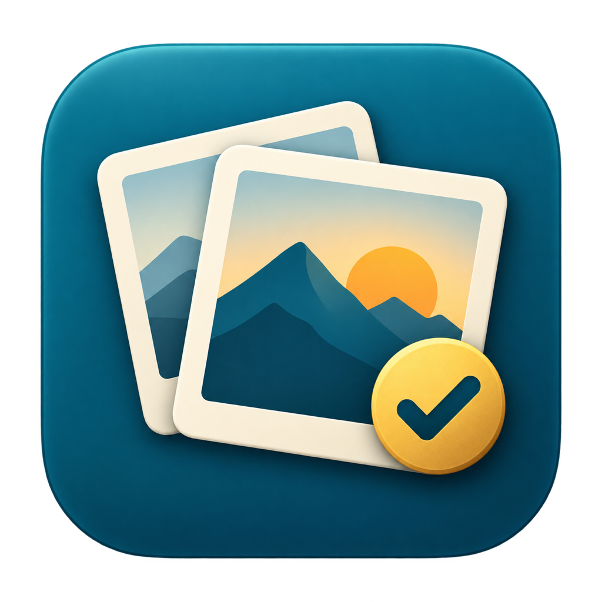
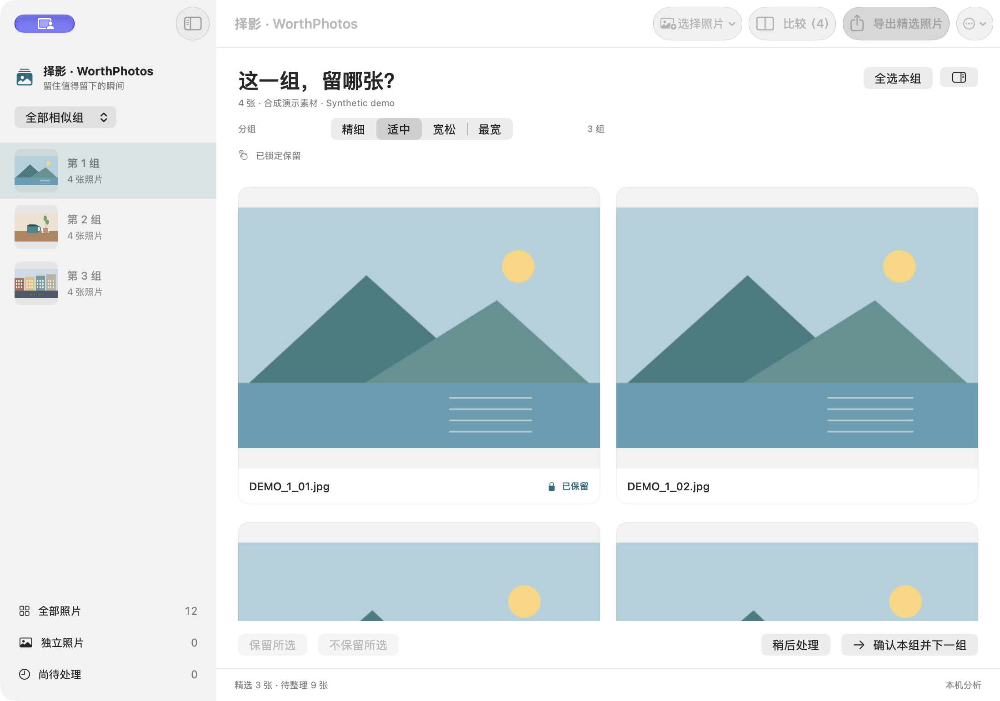
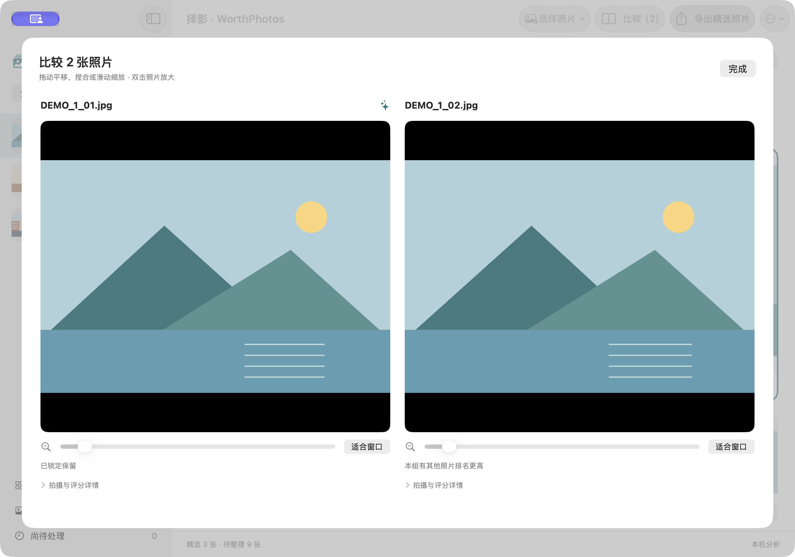
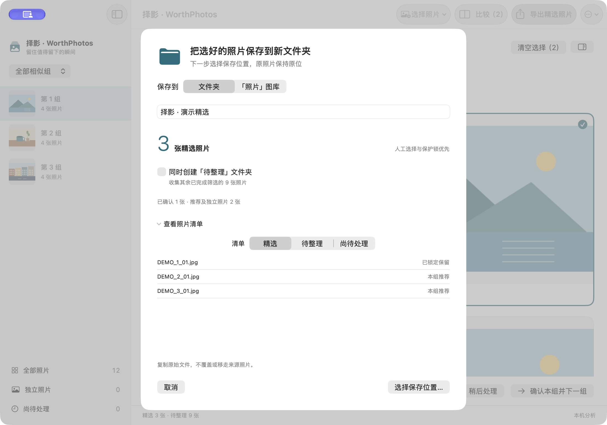

# 择影 · WorthPhotos

<p align="center"></p>
<p align="center"><strong>在本机，挑出值得留下的照片。</strong></p>
<p align="center"><a href="README.md">English</a> · <a href="https://github.com/zGzARY/WorthPhotosSelector/releases/latest">下载 macOS 版</a> · <a href="#快速开始">快速开始</a></p>

择影是原生 macOS 照片筛选工具，适用于日常、人像、活动、工作和旅行照片。它在本机将相似画面分组、提供质量排序参考，再由你确认值得保留的照片。

**Apple Silicon · macOS 15 或更新版本 · 中文界面 · 无需账号或远程分析服务**

> 原名“旅拍精选 / TravelSelect”。新名称对应更广泛的照片筛选场景；原有会话继续兼容。

## 下载与安装

1. 打开 [版本下载页](https://github.com/zGzARY/WorthPhotosSelector/releases/latest)，下载 **WorthPhotos-1.3.2-macOS-arm64.zip**。
2. 解压，将 **WorthPhotos.app** 拖入“应用程序”。
3. 打开应用并选择照片来源。连接 Apple「照片」或确认导入时才申请图库权限；文件夹和存储卡使用系统选择器授权。
4. 可选：用发布页的 **SHA256SUMS.txt** 核对 ZIP 文件的 SHA-256。

此下载版本采用 **ad-hoc 签名，尚未经过 Apple 公证**。如果 macOS 阻止打开你信任的应用，请按 [Apple 官方说明](https://support.apple.com/zh-cn/102445)，在“系统设置 → 隐私与安全性 → 仍要打开”中操作，可能需要管理员账号。无需关闭系统整体安全保护。

首个公开安装包仅支持 **arm64 / Apple Silicon**，未提供 Intel 版本。最低部署目标是 macOS 15，这不代表所有系统版本及相机型号均已实测。

## 主要功能

| 功能 | 使用方式 |
| --- | --- |
| 三类照片来源 | USB 相机／已挂载存储卡、文件夹、Apple「照片」相册与日期范围 |
| 相似照片分组 | 本机 Vision 特征结合拍摄时间，提供四档分组精细程度 |
| 多图比较与复核 | 并排比较、独立缩放、保留／不保留／稍后处理、保护锁和撤销 |
| 质量推荐 | 整体美学参考；明确确认可比较人物后，可结合人脸拍摄质量 |
| 小样本偏好校准 | 用 1 组或 3 组照片调整整体画面与人物质量的取舍 |
| 保留原片的输出 | 复制精选原文件到新目录、导入原片到图库，或生成精选相册 |
| 继续之前的选片 | 保存人工选择和复核位置，支持相机重连与导入进度恢复 |

推荐用于辅助判断，不保证选出最佳照片或表情。“不保留”表示本次输出不选它。**应用不会自动删除来源照片，也不会自动释放存储空间。**

## 快速开始

1. 点击 **选择照片**，选择相机／存储卡、文件夹，或「照片」相册和日期范围。选定后自动分析、分组。
2. 逐组查看，选择照片后点 **比较**，并排检查细节。
3. 确认保留、锁定重要照片，或稍后处理这一组。分组与偏好设置在 **更多** 或设置中。
4. 点击输出按钮，先核对目标、数量和名称，再确认。
5. 在 Finder 或「照片」中检查结果，确认输出前继续保留来源。

### 1. 按相似组复核



*真实中文界面，使用合成演示图片。图例展示操作流程，不代表真实照片选片准确率。*

### 2. 多图比较再决定



*同时检查候选画面，支持独立缩放及可展开的细节评分。人工确认与保护锁优先。*

### 3. 输出前核对清单



*先确认精选数量和保存目标；未完成分析或仍需复核的照片另行列出。*

## 来源与输出说明

- **文件夹：** 分析 JPEG、HEIC／HEIF 和 PNG。文件级完全重复检测仅用于文件夹；导出创建新目录，保留原文件字节并校验复制结果。
- **USB 相机／存储卡：** 使用 ImageCaptureCore 读取目录和预览。系统确认的 JPEG＋RAW 配对在导入原片时一起保留；具体格式与配对支持取决于相机和 macOS。视频不参与选片。
- **Apple「照片」：** 相册与日期条件取交集。普通相册输出引用已有资产；共享相册照片可能需要经确认保存副本到个人图库，因此会增加空间占用。Live Photo 仅分析静态部分；RAW 组合使用系统呈现图，不等于完整 RAW 编辑流程。
- **iCloud：** 默认不开启分析下载。明确开启后，macOS 可下载尚未在本机的图像供本机分析；此开关不控制「照片」自身同步。

已有相机会话使用恢复入口重连，保留组结构和人工选择；新增或变化的原片不会悄悄并入旧选片范围。

## 隐私与使用边界

分析使用 Apple Vision 在本机完成。应用没有照片上传、远程推理、账号、统计服务或人脸身份库。读取相机原片时不执行来源删除。

会话、偏好、分析缓存和输出回执保存在本机。导出的选择清单可能包含本地路径或资产标识，请按需要妥善保管。

整体美学与人脸拍摄质量是不同指标。缺失指标保持不可用，不替换为零。人物质量只有在满足可比较人脸和同主体确认条件时才参与推荐。偏好校准只调整有限指标的取舍，不代表训练了通用个人审美模型。

Fujifilm X-S20 样本已核对 JPEG＋RAW 原件保留；「照片」编辑器切换 RAW 原件的入口尚未验证，不能据此保证。相机兼容、纯云端照片、Live Photo 组合及大图库性能需要各自样本。项目尚未给出真实选片效果的准确率声明。

## 从源码构建

需要 Xcode 及 macOS SDK、Swift、Python 3 和系统命令行工具，没有第三方运行库。此次公开包使用 Xcode 26.6 构建，不声明较旧工具链已经验证。

```sh
# 生成发布 ZIP，不安装或覆盖应用
Scripts/package_release.sh

# 运行现有自动测试
Scripts/test.sh

# 可选：构建并安装本机 Debug 版
Scripts/build.sh
```

发布文件位于 `build/Release/`，可用 `WORTHPHOTOS_RELEASE_PATH` 指定其他位置。Debug 版默认安装到 `$HOME/Applications/WorthPhotos.app`，可用 `WORTHPHOTOS_DELIVERY_PATH` 指定位置。

也可以打开 `PhotosDuplicateClean.xcodeproj`，使用 **TravelSelect** scheme。内部 target 名、Bundle ID `app.local.TravelSelect` 和会话存储目录保留，用于兼容既有选片记录。

构建脚本将输入复制到本地临时目录，避免 iCloud 文件协调和文件元数据干扰。真实 Vision 测试需要 macOS 图像与模型服务；额外执行沙盒可能阻止相关测试运行。测试使用合成素材，不读取个人图库。

## 许可证

GNU General Public License v3，见 [LICENSE](LICENSE)。版本下载对应的源码和构建脚本一并公开在此仓库。
